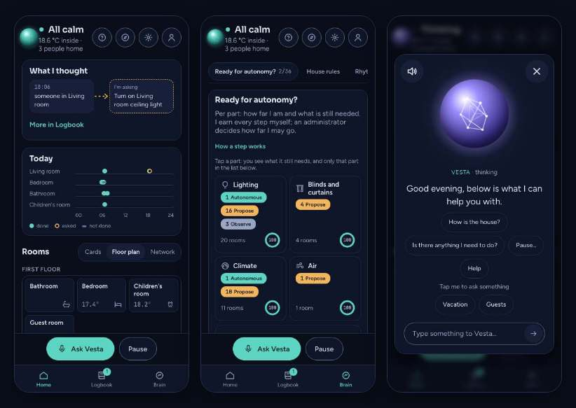

# HouseMind

**A house that thinks for itself.** HouseMind is a Home Assistant App that watches how your
household really lives, learns it room by room, and then simply takes care of it – light,
curtains, heating, fresh air, energy and safety. No automations, scenes or dashboards to build,
and it always tells you why it does what it does.



> Start with Demo mode if you like: an invented house to explore, while your own house is never
> touched.

[](https://my.home-assistant.io/redirect/supervisor_add_addon_repository/?repository_url=https%3A%2F%2Fgithub.com%2Fmvdwilden%2Fhousemind)

<!-- support:start – made by tools/build_support.py from docs/support.yaml -->
### Support HouseMind

Thank you to everyone who already supports HouseMind. HouseMind is free for everyone, without paid features. Support pays for the time to build it and to test it in real houses, and keeps it independent.

[](https://buymeacoffee.com/mvdwilden)

 

Do you like it? A star on GitHub helps others find it. https://github.com/mvdwilden/housemind

<!-- support:end -->

## Install in three steps

1. Click **Add to Home Assistant** above (or add `https://github.com/mvdwilden/housemind` under
   *Settings › Apps › App store › ⋮ › Repositories*).
2. Install **HouseMind**, start it and turn on **Show in sidebar**.
3. Open HouseMind. An administrator follows five short steps; everyone else gets a short
   introduction. HouseMind reads what Home Assistant kept of the last days and starts watching.

Needs Home Assistant OS or Supervised, version 2026.4 or newer, on a 64-bit machine (amd64 or
aarch64, such as a Raspberry Pi 4 or 5).

## What it does

- **It asks before it acts.** Per skill and per room it goes in three steps: it observes, it
  proposes ("Shall I turn on the light in the hall?"), and once it has proven itself it acts on
  its own. What you do yourself always wins, and every action has **Why?** and **Undo**.
- **Your automations become its lessons.** It reads the automations you already have, learns
  what they do, and asks before it takes one over. Wall switches and buttons stay yours.
- **Vesta, the voice of your home.** Ask anything by typing or talking, in the app or through
  Assist: *"Which lights are still on?"* – in plain words, also without any AI.
- **Everyone their own level.** Carefree, Informed, Involved or Expert: from one calm screen to
  every decision and a test of the house.
- **Any device, any brand.** It works out what each entity is, treats a group of lamps as one,
  and speaks English, Dutch, German and French.

More on the [website](https://mvdwilden.github.io/housemind/) and in the manual inside the app
(the question mark).

## Private and safe by design

- Runs entirely inside your own Home Assistant. What it learns stays in your house.
- Works without internet and without AI. No account, no cloud, no telemetry.
- AI is optional and only ever proposes; it never decides live. It never gets names of people
  or your address, and camera images never leave the house.
- One safety gate checks every action. HouseMind never turns off an alarm, and never opens a
  lock, a garage door, a gate or a door.
- Smoke, carbon monoxide, gas, a leak or frost: it reacts from the very first minute, also
  during a pause. It helps with safety, but does not replace certified detectors or alarms.

Found a security problem? Please report it privately – see [SECURITY.md](SECURITY.md).

## For developers

| Folder | Contents |
|---|---|
| `src/housemind/` | The App backend (Python 3.13, asyncio) |
| `frontend/` | The App user interface (Svelte + TypeScript) |
| `knowledge/` | Device catalogue, countries, languages and the manual (YAML, HTML) |
| `integration/` | The small Home Assistant integration (status, actions, Assist) |
| `ha_app_stable/` | The App as Home Assistant shows it |
| `tests/` | All tests, from the user's side |
| `docs/` | Website, App pages and QA summary (one source) |
| `tools/` | Build, site and signing tools |

```bash
uv sync
uv run pytest                      # backend tests
(cd frontend && npm ci && npm test && npm run build)
PYTHONPATH=src uv run python -m housemind --demo family_home --language en   # a demo house on http://127.0.0.1:8099
uv run ruff check .
uv run mypy
```

HouseMind is made by one maker and stays in that maker's hands: pull requests from others are not
taken in. Problems and ideas are very welcome – see [CONTRIBUTING.md](CONTRIBUTING.md).

## Licence

Free for everyone to install and use, with no paid features. The code is open to read, so you
can see what HouseMind does in your house – but not to change, copy into other software or pass
on: PolyForm Strict 1.0.0, see `LICENSE` and `NOTICE`. GitHub lets anyone look at and fork a
public repository; that gives no right to change HouseMind or use a changed copy. Versions up to
and including 0.4.3 were published under Apache-2.0 and stay under it.
