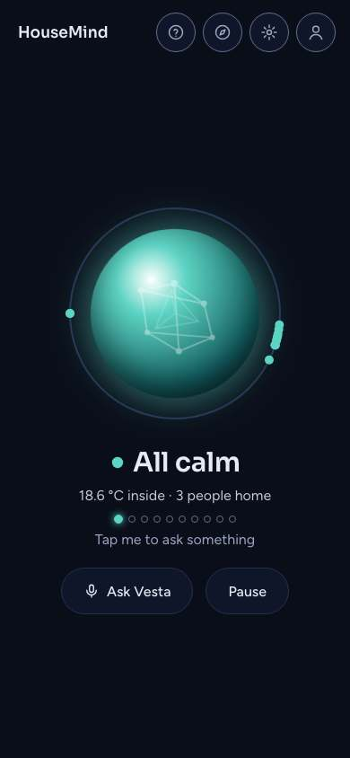
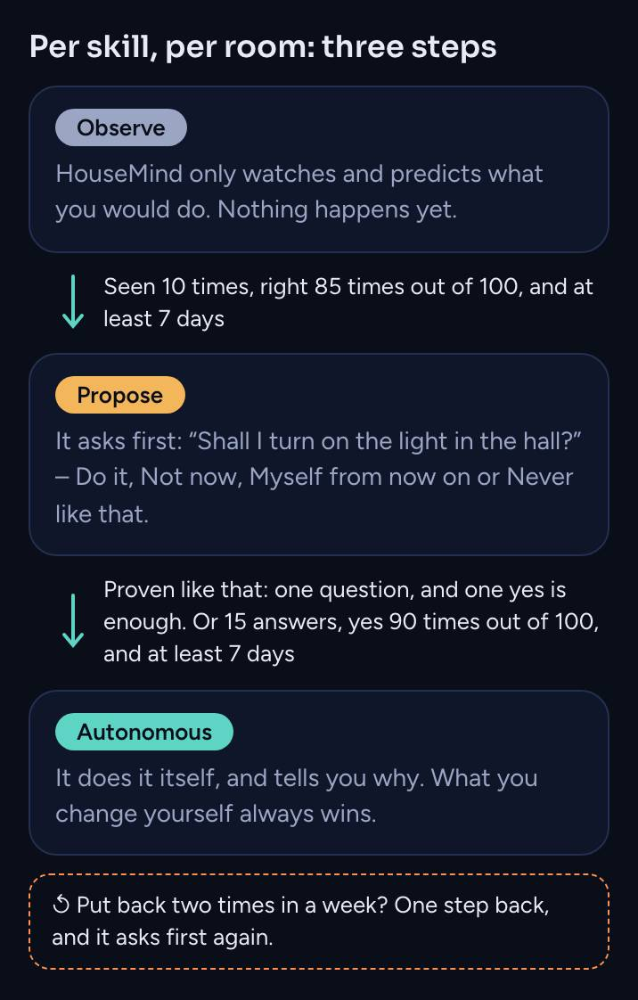
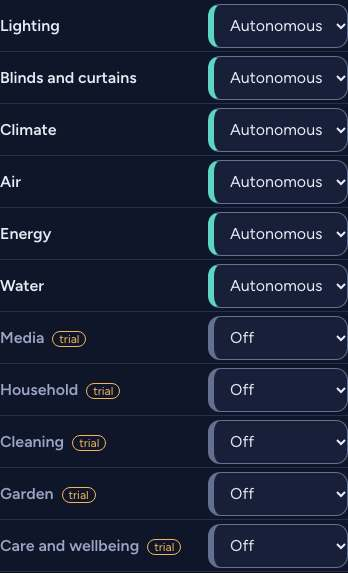
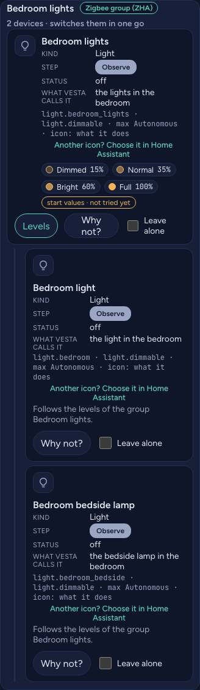
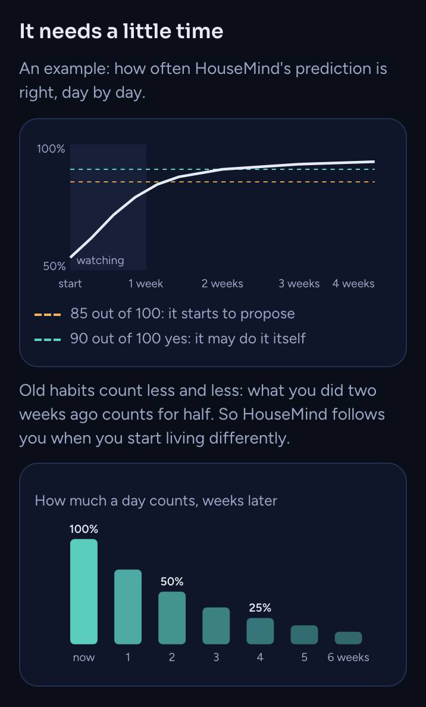
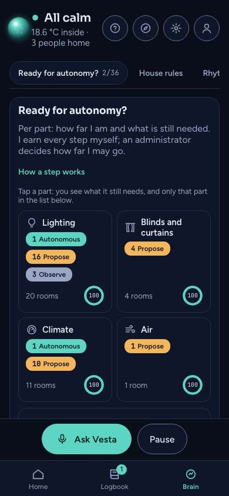
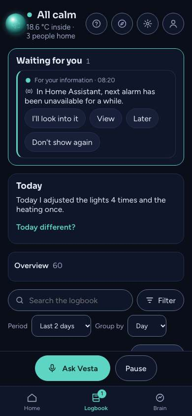
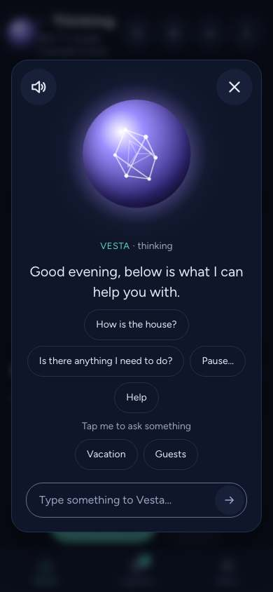
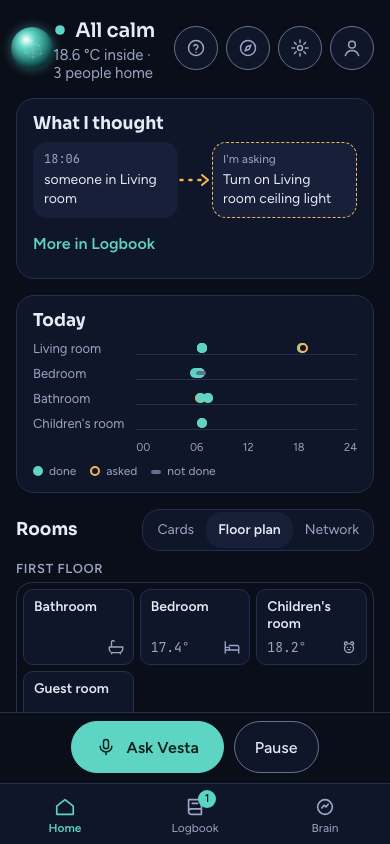

# HouseMind

**A house that looks after itself – calmly, explainably and safely.**

HouseMind is an App for Home Assistant. It learns how the people in your house live, and then
takes care of lights, curtains, heating and more for you. You do not write automations, scenes
or dashboards: HouseMind works it out itself, and always tells you why it does what it does.

## How it works

HouseMind looks at everything Home Assistant has: every device, and every entity of a device.
It works out what each one is, and learns per room how you live. Then it takes over, step by
step, one skill and one room at a time – for example "light on when you come in" in the hall.

### Three steps: Observe, Propose, Autonomous

1. **Observe** – HouseMind only watches and predicts what you would do. Nothing happens yet.
2. **Propose** – it asks first: "Shall I turn on the light in the hall?" You answer **Do it**,
   **Not now**, **Myself from now on** or **Never like that**. General knowledge may be asked
   after two hours; a habit it learns itself when its prediction is right 85% of the time, seen
   at least 10 times and for at least 7 days.
3. **Autonomous** – once that is proven, HouseMind asks one question in **Waiting for you**: may
   it do this itself from now on? One yes is enough. It also gets there through answers (90% yes
   of at least 15 answers and at least 7 days). If an automation in Home Assistant steers it, the
   question is about the whole automation, for an administrator: after a yes it goes off.

What you change yourself always wins: HouseMind backs off and learns from it. Put something
back two times in a week, and it goes one step back, asks first again, and an automation it took
over goes back on. An administrator decides per part how far HouseMind may go.

### Parts of the house

HouseMind works in parts: **Lighting**, **Blinds and curtains**, **Climate**, **Air**,
**Water**, **Media**, **Household**, **Cleaning**, **Garden**, and **Care and wellbeing**.
**Energy** shows what your house uses and makes, and gives advice; it does not steer a battery
or a car. New parts start switched off, and Care and wellbeing only with a yes from the person
it is about. Per part you choose: Off, Observe, Propose or Autonomous at most.

### Devices and entities

A device in Home Assistant has entities: a presence sensor may have presence, light level,
temperature and a status LED. HouseMind works out what each entity is – a lamp, the room's
thermostat, something that measures the air or the device itself, a status LED, or a setting
of the device – and acts on that everywhere. A setting it never changes, and the LED of a
sensor never counts as light in the room.

Light follows the day: brighter and whiter by day, softer and warmer in the evening, and a lamp
that burns goes along. If you have Adaptive Lighting, HouseMind reads its settings per group of
lamps; you keep setting them there. On Autonomous it switches that integration off for those
lamps and does it itself; after a step back it goes on again at once. Without that integration
HouseMind makes such a line itself for lamps that can, from what it learned in that room. What
you choose by hand stays until the lamp goes out.

Lamps in a group in their own network (such as a Zigbee group) go on and off together in one
message, so HouseMind uses the group – also in the Logbook and on Ready for autonomy?, one line
for the group, not one per lamp. What an administrator sets to **Leave alone** takes part
nowhere; a lamp left alone in a group goes along with its group. On Expert, **Brain › Devices**
shows everything per room and per device, with the lamps of a group indented under it. If
HouseMind cannot work something
out, an AI can help (if you want one); you can always confirm, or choose what it really is.

Every lamp dims differently: 40% is bright on one lamp and dusk on another. So every lamp has
four levels, each with its own brightness and colour: **Dimmed**, **Normal**, **Bright** and
**Full**. On Expert an administrator sets them in Brain › Devices with **Levels** at a lamp, and
tries them on the spot.

## It needs a little time

- **The first days it watches.** It reads what Home Assistant kept of the last days, so it does
  not start from nothing, and then follows what you do.
- **After about a week** the first proposals come, where its predictions are right. Other
  skills and rooms take longer: each goes at its own pace.
- **It keeps learning.** Old habits count less and less – what you did two weeks ago counts for
  half – so HouseMind follows you when you start living differently.
- **It adapts to your house:** how dark it must be per room before a light goes on, rooms you
  mostly walk through, how long the light stays on in an empty room, the moments you
  usually close the curtains, and when the outside light goes off in the evening.
- **It follows your rhythm.** Night, morning, day and evening come from your house, not the
  clock: night when the house sleeps, the morning when it wakes up, the evening when you
  usually come home. The light when you come in follows it, and a bedroom stays dark from
  your usual bedtime. Brain › Rhythm says what it is now.
- **Test the house.** On Expert, an administrator opens Test the house: choose a room and play
  out what happens – someone comes in in the dark, or the evening – and see what HouseMind
  would do and how that goes for real. Do it for real then does it in your house: the lamp goes
  on, the curtain closes, and after a minute everything goes back. A house rule or an
  automation stops it, with the reason. Walk around yourself puts one part of a room on
  Autonomous for 5, 15 or 60 minutes, with the real sensors. A test never counts for learning.
- **It takes over what your automations did.** An automation teaches it what it does, such as
  the outside light at sunset, or the driveway light when you come home in the dark. On
  Autonomous, HouseMind asks to switch that automation off and does it itself – and chooses
  what is best: the outside light also goes on when nobody is home, so the house looks lived in.
- **A button or switch stays yours.** An automation that only passes on a wall switch, a remote
  or a button in the app is your own hand: HouseMind works those lamps too, never asks to switch
  it off, and what it does counts as you.
- **A signal holds nothing back.** An automation that only shows something with a lamp, such as a
  colour for the alarm or a blink for the doorbell, stays on and teaches nothing. HouseMind keeps
  off the lamp while the signal lasts. An automation that only switches lamps goes along in the
  question once their rules are proven; one that does more keeps only its own lamp.
- **Your choice stands while you are there.** If you work a lamp yourself, HouseMind keeps off it
  as long as someone is in the room. If the room has been empty and someone comes in, that is a
  new moment. Without a presence or motion sensor it cannot see that a room is empty, so it does
  not put the light out there.
- **A pet is no one at night.** In rooms an administrator marks for pets, what only a sensor sees
  is perhaps the pet while the house sleeps or nobody is home – a presence sensor too, as it sees
  a dog just as well. No lamp goes on for it, and the dog does not wake the house. A camera that
  sees a person there, a hand on a switch, or someone coming from a room without pets does count.
- **Every room its own light.** Rooms that share one presence sensor with a zone each, such as an
  open kitchen and dining room, are rooms of their own: walk into the kitchen in the dark and its
  light goes on, also when the dining room is lit. If you keep switching it off then, HouseMind
  learns that the light next door is enough there.
- **A shower keeps the light on.** If the humidity in the bathroom climbs fast while someone was
  just there, someone is showering: the light stays on, also when the sensor cannot see you
  behind the curtain, and a fan there goes on at once.

**Ready for autonomy?** in Brain shows for every part how far it is, and what is still needed.

## Morning, evening and night

- **Waking up slowly.** The light comes up gently and the house is already warm. The curtains
  open when you get up.
- **The morning briefing.** When the house wakes up, Vesta briefly tells the weather, the
  calendar, something about electricity and what is still open – once.
- **The overview of the day.** In the evening, what is good to know, in one message.
- **Good night.** When the house goes to sleep, the lamps in rooms where nobody is go off – also
  in a room without a sensor – and curtains that are still open close. Never in a bedroom, and
  never outside.
- **Coming up.** Brain › Rhythm shows the next moments, and per moment whether HouseMind will do
  it, ask first, or would only do it.

## Heads-ups

HouseMind reports small things that need attention; for these it does nothing itself:

- a battery almost empty, a filter to replace soon, or the waste the evening before collection;
- a smoke, carbon monoxide, gas or leak detector that has not responded for a day;
- a boiler that has not heated the water for more than a day, while it is at least 10 degrees
  colder than it is set to – look at the device or its own app; the heads-up goes away by itself
  once it heats again;
- water that keeps running, a fridge door open for a few minutes, an oven or hob on while
  nobody is home (HouseMind asks whether it may switch it off), or a socket that gets too hot;
- stuffy air: CO₂ at 1,200 ppm or more for a quarter of an hour where someone is – open a window
  for a while; once a day per room, and at night not at all: the morning briefing tells you.
- water that runs away a little every hour in the night, while nobody uses any – a dripping tap
  or a toilet that keeps running; once, in the morning;
- rain within the hour while a window or outside door is open, with what is open;
- a device that reports a fault itself, such as a heat pump; overheating or overload is important.

You get at most five new heads-ups a day, not counting an emergency detector, the boiler,
stuffy air, water, rain or a dangerous fault.
What is only for your information comes together in the overview of the day.

Administrators also get the **Check-up**: every hour HouseMind looks at what is broken in Home
Assistant itself – an integration that does not start, a device that does not respond, a
duplicate entity – and explains it in plain words. It never deletes anything, and only switches
something off after a yes.

## Everything it does, with the reason

The **Logbook** shows what HouseMind did or left, as a short story: what it saw, what it
thought and what it did. A line that flows was done, dots wait for you, a line that stops was
not done. On Informed, tap **Why?** for the reason; from Involved the line says it. **Undo** puts
it back. A question, your answer and what came of it are one line.

On Expert, a line folds open to the safety checks of that decision, in words: which passed,
where it stopped, or which it never reached.

## Meet Vesta

Vesta is the voice of your house: the glowing ball in the app. Her colour shows how the house
is doing – aqua when all is calm, violet while she thinks, amber when she has a question,
orange when something needs you, red in an emergency, indigo at night and grey during a pause.

Tap her, or tap **Ask Vesta**, and she asks what she can do for you. You can talk or type:
"Is the back door closed?", "Which lights are still on?", "Pause the lights for an hour",
"Why did the light go on?". She answers in plain words, also without any AI.

## As calm or as detailed as you like

Everyone in the house picks their own level, and can change it at any time:

- **Carefree** – one calm screen. HouseMind just does its job; you only hear from it in an
  emergency.
- **Informed** – you see what happens and why, and get a simple yes/no question now and then.
- **Involved** – you approve proposals and make house rules, such as "never open the curtains
  before 7:00".
- **Expert** – you see and set everything, down to every decision.

After an update, HouseMind tells you once what is new, as much as fits your level: one
sentence on Informed, a short list on Involved and Expert, and nothing on Carefree – it just
works.

## Safety

- Smoke, carbon monoxide, gas, a leak or frost: HouseMind reacts from the very first minute,
  also during a pause, and everyone with the Home Assistant app on their phone gets a message.
- It never turns off an alarm, and never opens a lock, a garage door, a gate or a door.
- The alarm is a few lines in the Logbook: switched on, gone off with what HouseMind did, and
  switched off. A minute after it is switched off, the lamps and curtains go back to how they
  were just before it went off.
- Whatever you change yourself wins: HouseMind backs off and learns from it.
- AI is optional and only ever proposes; everything goes through the same safety checks, and
  the core never waits for the AI.

## Getting started

HouseMind is an App: it needs Home Assistant OS or Supervised, version 2026.4 or newer, on a
64-bit machine. It gets its connection to Home
Assistant through the Supervisor, so there is no IP address or key to fill in. Home Assistant no
longer supports Supervised since 2025.12; HouseMind still works there and tells the administrators
once, calmly.

1. Install the App and start it. Turn on **Show in sidebar**.
2. Open HouseMind. An administrator sees **Set up**, with five short steps:
   1. the introduction: your level, messages in danger, learning, pets;
   2. the link with Home Assistant: tap **Place the integration**, then **Restart Home Assistant now**,
      then in Home Assistant go to **Settings › Devices & services**, click **Configure** at the
      discovered HouseMind and then **Submit**. This gives you HouseMind in Home Assistant and
      lets you talk to Vesta through Assist;
   3. Vesta: her name and her voice;
   4. an AI, if you want one (you can skip this);
   5. done: HouseMind reads what Home Assistant kept of the last days and starts watching.
3. Other people in the house only do their own short introduction.

Want to look around first? Turn on **Demo mode** in the App's options and pick a **Demo house**:

- **simple** – twelve devices, what most people start with: a few lamps, a thermostat, a motion
  sensor in every room, a door contact, a smoke detector and a leak sensor;
- **average** – almost forty devices, like a household that has used Home Assistant for a while;
- **extended** – every kind of device HouseMind knows, from lamps and curtains to the home
  battery, the charge point, the alarm and the robot mower.

HouseMind then shows that invented house and never touches your own devices or data. Each demo
house keeps its own memory.

Everything else is in the app: **My preferences** for each person, **House settings** for
administrators, **Help** (the question mark), which opens the full manual with a box to ask
Vesta, and the **Tour** (the compass) beside it, in Dutch, English, German and French.

## Privacy

<!-- The privacy statement: tools/app_docs.py puts the App's own here. -->

The full statement, in your language, is in the App under About HouseMind.

HouseMind helps with safety, but it does **not** replace certified smoke detectors, CO detectors
or alarm systems.
