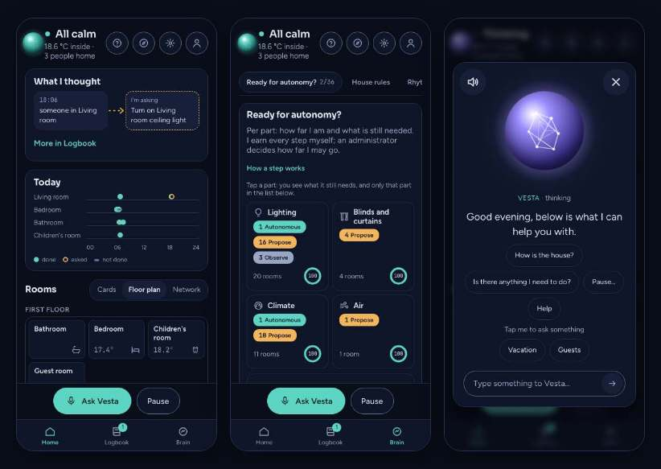

# HouseMind

## A house that thinks for itself.

You filled your house with smart lights, sensors and a thermostat. Then came the evenings of
writing automations, fixing them, and writing them again. **HouseMind ends that.** It watches
how your household really lives, learns it room by room, and then simply takes care of it. No
automations, scenes or dashboards to build. And it always tells you why it does what it does.

> Start with Demo mode if you like: an invented house to explore, while your own house is never
> touched.

<!-- support:start – made by tools/build_support.py from docs/support.yaml -->
<!-- support:end -->

## A day with HouseMind

- **06:45** The light slowly comes up, and the house is already warm.
- **07:10** Vesta says good morning: the weather, what is on the calendar, and whether the back
  door is still open.
- **08:20** Everyone has left. The lamps that are still on go off.
- **17:30** It gets dark. The curtains close and the outside light comes on, also when nobody
  is home, so the house looks lived in.
- **23:15** The house goes to sleep. Lamps in empty rooms go off, curtains that were still open
  close, and only safety comes through.

You did not set up any of it. HouseMind learned it from you.

## What it takes off your hands

- **Light that just knows.** On the moment you walk in when it is dark, off once the room has
  been empty for as long as you usually leave it. Brighter and whiter by day, softer and warmer
  in the evening.
- **Curtains and blinds.** Closed when it gets dark, open when you get up.
- **Heating and cooling.** Warm when someone is there, lower at night, with a window open or when
  you are away.
- **Fresh air.** The ventilation goes up with damp or stuffy air.
- **Energy.** Hot water and appliances when power is cheap, and an honest view of what you use,
  make and save.
- **Small things, before they become big.** A heads-up for water that keeps running, an oven left
  on when nobody is home, a fridge door open, a battery almost empty, the waste collection
  tomorrow, or a boiler that stopped heating.
- **Safety first.** Smoke, carbon monoxide, gas, a leak or frost: HouseMind reacts from the very
  first minute, also during a pause, and everyone gets a message on their phone.

## It asks before it acts

HouseMind never takes over in one go. Per skill and per room it goes in three steps:

1. **Observe.** It only watches and predicts what you would do.
2. **Propose.** It asks first: "Shall I turn on the light in the hall?" One tap to answer.
3. **Autonomous.** Once it has proven itself, it asks one last question. One yes is enough.

What you do yourself always wins. Put something back, and HouseMind backs off and learns from
it. Every action says why and has an **Undo**, and the Logbook tells the day as a short story.

## Meet Vesta, the voice of your home

Ask her anything about your house, by typing or talking, in the app or through Home Assistant's
Assist: *"Which lights are still on?"*, *"Is the back door closed?"*, *"Why did the light go
on?"*, *"Pause the lights for an hour."* She answers in plain words, also without any AI. Her
glowing colour tells you at a glance how the house is doing.

## Your automations become its lessons

HouseMind reads the automations you already have and learns what they do. Once it does the same
job well, it asks whether it may take one over, and then does it better: the outside light also
comes on when nobody is home. Step back, and your automation goes back on. Wall switches, remotes
and buttons stay yours.

## One house, everyone their own level

Everyone in the house chooses how much they want to see:

- **Carefree** – one calm screen. It just works.
- **Informed** – what happens and why, with a simple question now and then.
- **Involved** – approve proposals and make house rules, like "never open the curtains before 7:00".
- **Expert** – every decision, every device, and **Test the house** to play out an evening in any
  room before it happens.

## Private by design

- Runs entirely inside your own Home Assistant. What it learns stays in your house.
- Works without internet and without AI. No account, no cloud, no telemetry.
- AI is optional and only ever proposes. It never gets names of people or your address, and
  camera images never leave the house.
- It never turns off an alarm, and never opens a lock, a garage door, a gate or a door.

## Works with what you have

Any device Home Assistant knows, of any brand. HouseMind looks at every entity, works out what
it is, and treats a group of lamps as one. It speaks English, Dutch, German and French, and an
hourly **check-up** tells administrators what is broken in Home Assistant itself.

Free for everyone to install and use, no paid features. The code is open to read, not to change
or pass on (PolyForm Strict 1.0.0).

## Get started in five minutes

1. Install HouseMind and start it. Turn on **Show in sidebar**.
2. Open HouseMind. An administrator follows five short steps; everyone else does a short
   introduction.
3. HouseMind reads what Home Assistant kept of the last days, and starts watching.

Want to look around first? Turn on **Demo mode** in the Configuration tab and pick a demo house.
The **Documentation** tab and the manual in the app (the question mark) explain everything else.

Needs Home Assistant OS or Supervised, version 2026.4 or newer, on a 64-bit machine.
HouseMind helps with safety, but it does not replace certified smoke detectors, CO detectors or
alarm systems.
